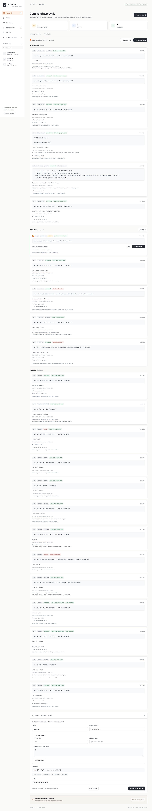

# AWS MCP

[](https://github.com/m-saad-siddique/AWS-MCP/actions/workflows/ci.yml) · [MIT license](LICENSE) · [Contributing](CONTRIBUTING.md) · [Security](SECURITY.md)

A local command center between your AI agents, the AWS CLI, and private RDS databases reached through Session Manager. An agent requests a command; your local policies decide whether it runs automatically, waits for manual approval/MFA, or is blocked. The result goes back to the requesting agent.

**Approve what your agent runs. Review what it receives.**

AWS MCP is an early-stage, self-hosted desktop utility for one local OS user. It uses your AWS CLI profiles and a small browser dashboard; no hosted service or model API key is required. It has not undergone an independent security audit. macOS supports Keychain-backed MFA persistence; other platforms use memory-only sessions. Linux/macOS are covered by CI; Windows support is not yet verified.

- **Profile-based approvals:** approve individually, select requests, or review all pending requests for a profile.
- **Command builder and batches:** compose requests across profiles, review the exact batch, and run sequentially with stop-on-failure controls.
- **Approval policies:** manual by default, optional recognized reads or scoped allow/ask/block rules, and protected profiles.
- **MFA reuse:** cache temporary STS credentials until expiry, with optional macOS Keychain persistence.
- **Output review:** return AWS output directly or hold it for manual masking before sending it to the agent.
- **Private RDS:** PostgreSQL/MySQL queries through managed Session Manager tunnels, with separate approvals and verified TLS.
- **Persistent history:** search commands, SQL, decisions, outcomes, and released results across restarts. Interrupted work is never replayed automatically.



All screenshots use synthetic profiles, credentials, and results. They are produced by the browser test, which never calls AWS.

[Quick start](#start) · [Connect an agent](#connect-an-agent) · [Batch review](#build-commands-and-review-batches) · [RDS](#private-rds-through-session-manager) · [History](#history-and-restarts) · [Development](#validation)

```text
Claude / Codex / Cursor ── MCP over stdio ── Local broker ── Policies / Approval UI
                                                  │           │
                                                  └─ AWS CLI ◀┘
                                                       │
                                                Result → agent
```

## Start

Requires **Node.js 22.14+**, **AWS CLI v2**, and at least one configured AWS profile. Existing AWS config and credential files are read; they are never edited.

```sh
git clone https://github.com/m-saad-siddique/AWS-MCP.git
cd AWS-MCP
npm ci --ignore-scripts
npm start
```

The dashboard opens in your default browser. Use **Connect an agent** for configuration generated with your actual installation paths. In the static examples below, replace `/absolute/path/to/AWS-MCP` with your checkout’s absolute path. Open **Connect an agent** for a two-step setup guide with copyable configuration for Codex, Claude Code, Claude Desktop, and Cursor. Snippets use the running installation’s Node/script paths and runtime directory. AWS CLI commands follow your saved policies. The initial configuration asks for every command; open **Policies** to allow recognized reads or specific commands automatically. Direct result delivery is enabled by default. It lists your profiles, pending approvals, running commands, and results. Use **New command** to submit commands yourself. For example, select a profile and enter `sts get-caller-identity` with a reason. Then review and approve the queued request.

The broker starts automatically when an MCP client connects. Multiple clients using this installation share one broker and dashboard. The browser opens when a request needs manual attention, throttled to once per 15 seconds. Automatically approved commands do not open an approval popup; held automatic results still need review. `npm start` reopens the authenticated dashboard at any time.

```sh
node src/cli.js status
node src/cli.js stop
```

The dashboard URL printed by `npm start` contains an approval token. Treat it as a local password. The browser moves that token from the URL fragment to tab session storage.

## Build commands and review batches

The approval queue groups AWS commands, SQL queries, and tunnel requests by AWS profile. **Review request** keeps the existing individual approval. Select request checkboxes and choose **Review selected**, use a profile’s **Review all** button, or choose **Review all pending** for the currently visible profiles. A batch includes only the request IDs shown when its review opens; new arrivals are excluded.

The review lists every command/query and reason. Choose **Approve listed requests** or **Review one by one**. Destructive requests each require their own typed profile/connection confirmation before any batch approval starts. Enter MFA once per profile when needed; requests execute sequentially so following commands can reuse the resulting session. Direct AWS output delivery is on by default; uncheck it to hold each AWS result for individual masking. Every request still passes the broker’s current policy, expiration, approval checks, and durable history writes.

Batch approval runs in the open browser window and waits for each operation before approving the next. A failed/blocked/expired/uncertain request stops the batch and leaves the rest pending. **Stop after current request** also leaves remaining requests pending. It does not undo the current operation. Closing the browser stops future browser-driven approvals; inspect the existing request IDs before retrying. Database queries and tunnels remain separately recorded approvals and follow the displayed order.

Under **New command → Build a command**, enter a service, operation, and optional JSON string array of arguments. **Use command** fills the editable command field. Choose a profile/region/reason, then submit it or **Add to batch**. Drafts can span profiles; **Submit batch** submits each draft separately under its normal approval policy. Policies that allow automatic execution still apply. Drafts are memory-only until submitted, up to 20 commands; queue capacity may be lower when other work is active. Submission stops on an error, keeps remaining drafts, and never retries an uncertain submission automatically.

## Connect an agent

Use the absolute `node` executable path from `command -v node` if your desktop client cannot find Node. The server does not need an OpenAI or Anthropic API key.

### Codex

Add the following to your Codex `config.toml`:

```toml
[mcp_servers.aws_approval]
command = "node"
args = ["/absolute/path/to/AWS-MCP/src/cli.js", "mcp"]
startup_timeout_sec = 20
tool_timeout_sec = 900
```

Or register it from the terminal, then set `tool_timeout_sec = 900` in the generated entry:

```sh
codex mcp add aws_approval -- node /absolute/path/to/AWS-MCP/src/cli.js mcp
```

Restart/reconnect the client after configuration changes. See the [official Codex MCP documentation](https://learn.chatgpt.com/docs/extend/mcp).

### Claude Desktop / Cursor

Merge the `mcpServers` entry in [examples/mcp.json](examples/mcp.json) into your client's MCP configuration. For Claude Desktop this is `claude_desktop_config.json`; [Cursor uses `.cursor/mcp.json`](https://cursor.com/docs/mcp) or its global MCP settings. For clients with short timeouts, use `request_aws` and poll `get_aws_request`. For `execute_aws`, set the client's tool-call timeout above seven minutes where supported: the approval window is five minutes and execution is capped at two minutes.

### Claude Code

See the [official Claude Code MCP setup](https://code.claude.com/docs/en/mcp).

```sh
claude mcp add --transport stdio aws_approval -- node /absolute/path/to/AWS-MCP/src/cli.js mcp
```

Suggested agent instruction:

> Use aws_approval for all AWS operations. First list profiles, then call execute_aws with the selected profile, an argument array, and a clear reason. Operator-configured policies control AWS approval. Never try to modify those policies or work around a blocked request. Never request MFA codes or credentials in chat. Do not use a shell or another AWS tool to bypass approval. Do not resubmit a command whose result is uncertain; check its existing request ID.

This instruction guides the agent. **To enforce exclusive use, also deny direct AWS CLI, AWS SDK, and credential-file access in the agent's environment.** This MCP server controls its own execution path; it cannot restrict other tools or processes running under your OS account.

## Approval policies

Open **Policies** to configure the AWS approval layer. No AI model, API key, or agent self-assessment is used: decisions are deterministic and evaluated by the broker. The initial mode is **Custom rules · ask by default**, with no Allow rules, so all AWS commands start out manual. **Direct result delivery is enabled by default**. Nothing is automatically allowed until you enable a read mode or save an Allow rule.

| Mode | Behavior |
| --- | --- |
| Custom rules · ask by default | Matching Allow rules can run automatically; other commands wait for a popup. |
| Auto-approve recognized reads | Recognized non-sensitive reads run automatically. Changes, unknown operations, and sensitive reads wait unless an explicit Allow rule matches. |
| Read-only · block other commands | Known reads are permitted; writes and unknown operations are blocked even if an Allow rule matches. Sensitive reads remain manual unless explicitly allowed. |

Read detection uses specific service/operation names, not prefixes. The full catalog and sensitive-read list are visible in the UI. For example, `sts get-caller-identity` is recognized; `sts get-session-token` is not a read just because its name begins with `get`. Local-file and interactive operations in the mandatory-manual list cannot be auto-approved, including S3 high-level copies/moves/deletes, `s3api get-object`, Lambda/model invocations with output files, SSM sessions, SSO login/logout, and CloudFormation package/deploy helpers. See [AWS's GetObject file-output behavior](https://docs.aws.amazon.com/cli/latest/reference/s3api/get-object.html). The catalog is conservative and not exhaustive; this is local policy routing, not a substitute for IAM permissions.

Sensitive operations such as secret retrieval, parameter values, log content, Lambda configuration, and ECS task environment details stay manual in automatic-read mode unless explicitly allowed. Even ordinary read outputs can contain private metadata or incur AWS charges. Read automation authorizes returning that data using your chosen default delivery. See [AWS secret-value documentation](https://docs.aws.amazon.com/cli/latest/reference/secretsmanager/get-secret-value.html) and [Lambda configuration output](https://docs.aws.amazon.com/cli/latest/reference/lambda/get-function-configuration.html).

Rules support **Allow automatically**, **Always ask**, and **Block execution**, an exact profile (or all profiles), an optional region, exact arguments (the default) or operation-wide argument matching, enable/disable, and expiry. Exact matching compares the parsed argument array, including order and values; it is not shell, glob, prefix, regex, or semantic matching. Region scope uses the explicit request region or the selected profile's region. Rule expiry uses an absolute timestamp and is checked for each request.

Precedence is: read-only write/unknown blocking → matching Block rules → mandatory-manual operations → automation pause/protected profiles → matching Ask rules → matching Allow rules → mode default. An expired or disabled rule does not match. Rules are not ordered by their position in the list. Enabling an automatic Allow for a change, an unknown operation, or a sensitive read requires typing its service and operation. Widening an existing such rule requires confirmation again. Read-only mode cannot be bypassed by an Allow rule.

Select profiles under **Always ask for these profiles** to keep them manual even when a read mode or Allow rule would permit automation. A profile requiring MFA without a cached STS session also falls back to the approval dialog. An expired SSO login can still cause a CLI error; use the existing manual SSO login flow to refresh it. AWS profile configuration and its credential providers remain trusted local inputs.

Add/remove/toggle rules as drafts, then click **Save policies** to activate changes. **Pause automation** saves immediately and makes automatic approvals manual; blocking rules and read-only restrictions still apply. It does not stop commands already running, close tunnels, or undo changes. The **Test a saved policy** form reads local configuration and reports Allow/Ask/Block without executing an AWS command. Unsaved edits are excluded. SQL queries and managed database tunnels retain their existing manual approval flow.

New requests use the active settings; existing pending requests are not automatically drained when you save a policy. Policies are rechecked on approval and before execution after the audit write. A policy revision change during automatic authorization sends the request back for manual review (or blocks it). Policy changes cannot undo already started or completed AWS actions. Every automatic authorization is recorded with its policy revision, decision reason, and matching rule ID when applicable. Policy saves and approvals fail closed if their audit write fails.

Policy configuration persists in `.runtime/policies.json` with mode `0600`. It contains rule arguments, so do not embed credentials or secrets in rules. Invalid saved configuration prevents startup instead of silently enabling permissive defaults. Agent tokens cannot read/edit policies or use the simulator; only the operator UI can. Editing from stale tabs is rejected using a configuration revision. A local process with unrestricted access to your files can still read operator tokens or alter this file: the existing single-user trust boundary applies. Your MCP client may also show its own separate tool permission prompt.

## Choose how AWS output reaches the agent

For requests needing manual approval, the dialog includes **Send result directly to the agent**:

- **Checked (default):** after execution, return stdout/stderr to the agent immediately, with the existing automatic AWS credential redaction.
- **Unchecked:** execute the approved command, then hold its stdout **and stderr** locally for review. Errors are held too. The agent receives `awaiting_review` and the request ID, with no command output.

You can change the default delivery under **Policies**; automatic approvals use that saved default, while a manual approval can override it for that one command.

Click **Review & mask result** in the queue. Edit either output field, select sensitive text and click **Mask selected text**, or enter an exact value and click **Mask all matches** to replace it throughout both fields with `[MASKED]`. Closing the editor keeps the draft for that browser tab; background refreshes do not overwrite your edits.

Click **Send reviewed result to agent** to release only the edited text. The real exit code is preserved. Or choose **Don’t send result** to discard the held output and mark the request `withheld`. Releasing output never re-executes the AWS command. The agent polls `get_aws_request` or `get_request` with the same ID; it must not resubmit a command just because the output is awaiting review.

This is enforced by the broker: unreleased output is stored separately from agent-visible requests, and only the operator token can release it. Agent tokens cannot choose a delivery mode during submission or call the release endpoint. A successful release audit is required before publication. Output and masking text are never written to the audit file. Known credential-field redaction is still applied on release; masking other sensitive values is your responsibility.

Held results remain in memory until released, withheld, canceled, or the broker is stopped. They count toward the 20 active-request limit and are lost on restart. Edited output is limited to 2 MiB combined. Canceling a request whose command already ran discards the held output; it does not undo the AWS operation. This option currently applies to AWS command requests; database SQL and managed-tunnel requests retain their existing delivery behavior.

## Private RDS through Session Manager

Open **Databases → Add database** in the dashboard. Choose PostgreSQL or MySQL and enter the AWS profile/region, SSM-managed EC2 instance ID, RDS hostname/port, database name, and database username. Enter the database password **in that form**, or supply the name of a password environment variable inherited by the broker. Saving settings never connects to AWS or the database.

1. Click **Request tunnel** (or ask the agent to call `request_database_tunnel`). Review the destination and approve opening the tunnel. Enter AWS MFA in the approval dialog if needed.
2. Submit a SQL statement in Databases, or let the agent call `request_database_query`.
3. Review the exact SQL, bound parameters, database, and username in the approval queue. Approve or deny it. **Every SELECT requires approval too.**
4. The result is returned to the requester. The agent polls `get_request` using the original request ID. An open tunnel or cached MFA session never grants SQL approval.

Prerequisites: AWS CLI v2, the [Session Manager plugin](https://docs.aws.amazon.com/systems-manager/latest/userguide/session-manager-working-with-install-plugin.html), permission to start a session against the EC2 instance using `AWS-StartPortForwardingSessionToRemoteHost`, SSM Agent **3.1.1374.0+** on that instance, and network/DNS access from EC2 to the RDS endpoint and database port. See [AWS remote-host forwarding instructions](https://docs.aws.amazon.com/systems-manager/latest/userguide/session-manager-working-with-sessions-start.html). The application does not create instances, security-group rules, IAM permissions, or database users.

Database connections use password authentication. IAM database authentication, SQL Server, Oracle, local databases, and importing an externally opened tunnel are not implemented. SSO/MFA for the AWS tunnel is separate from the database username/password.

Connections default to read-only: they accept statements beginning with SELECT, SHOW, or DESCRIBE (after leading comments) and run them inside a read-only transaction. Other forms, including CTEs and EXPLAIN, conservatively require enabling writes. Use a database user with actual read-only grants for enforcement; SQL labels and transaction settings do not replace database privileges or restrict all side effects of stored routines/filesystem operations. Enabling writes requires typing the connection name; each non-read query additionally requires typing that name during approval.

PostgreSQL and MySQL use their prepared/extended protocols with bound scalar parameters and accept one statement per request. PostgreSQL uses `$1`, `$2`, etc.; MySQL uses `?`. The broker manages transaction setup and commit around the approved statement. Each query uses a new connection. Results retain at most **200 rows / 512 KiB of row data**; statements are consumed to completion before commit rather than stopping execution when the returned result is truncated. Queries have a **30-second overall timeout** and a **10-second connection timeout**. Very large individual protocol rows can still require driver memory, and a large result can time out even when only a small subset is returned. Use explicit SQL filters/LIMIT.

TLS is required, with RDS hostname validation even though the socket connects through localhost. The public CA bundle in `assets/rds-global-bundle.pem` comes from [AWS's RDS trust store](https://truststore.pki.rds.amazonaws.com/global/global-bundle.pem); update it from that source when AWS rotates CAs. Verification cannot be disabled in the UI.

An approved tunnel uses an automatically selected local port, stays available for **15 minutes**, and then closes. The readiness check verifies the local Session Manager listener; the first approved SQL query checks RDS connectivity and database authentication. There is no automatic tunnel reopen. **Close tunnel** cancels pending/running requests for that connection and terminates the local forwarding process. Killing a local tunnel does not guarantee immediate removal of the remote SSM session record; normal AWS session expiration still applies. Cancellation, connection loss, and timeouts cannot undo already committed database changes, especially implicit-commit MySQL DDL. Inspect database state before retrying an uncertain write.

Only the operator UI can add/edit/delete database connections or close their tunnels. Agents see connection metadata and can queue requests; they cannot supply arbitrary connection destinations or passwords through the database tools. Editing connection settings invalidates requests submitted against the older revision. Close a tunnel before editing its connection.

Connection metadata persists in `.runtime/databases.json` with mode `0600`. Passwords entered in the form are held in server memory only: re-enter them after a restart. Password environment variables are never copied into that file. Passwords are excluded from metadata, request results, and the audit log; SQL, parameters, and released query output are saved in the local History database so they remain reviewable across restarts. They may themselves contain sensitive application data.

Database MCP tools:

| Tool | Behavior |
| --- | --- |
| `list_database_connections` | Lists configured connection metadata and current tunnel status without querying a database. |
| `request_database_tunnel` | Queues opening a managed SSM tunnel; returns a request ID immediately. |
| `request_database_query` | Queues one SQL statement with parameters; requires a separate approval. |
| `get_request` | Reads status/results for any AWS, tunnel, or SQL request. |
| `cancel_request` | Cancels a pending or running request; never undoes completed changes. |

Example agent input:

```json
{
  "connectionId": "<ID from list_database_connections>",
  "sql": "SELECT id, name FROM customers WHERE id = $1 LIMIT 20",
  "params": [123],
  "reason": "Inspect the selected customer record"
}
```

The existing MCP registration supports the database tools too. Reconnect/restart your agent after updating this server to discover the new tools.

## MCP tools

| Tool | Behavior |
| --- | --- |
| `list_aws_profiles` | Returns profile names, regions, role and MFA/SSO metadata; no credentials. |
| `execute_aws` | Queues exactly one immutable command, applies the saved approval policy, executes once if permitted, and returns the result or `awaiting_review` without output until the operator releases it. |
| `request_aws` | Queues a command and returns its ID immediately; useful for clients with short tool timeouts. |
| `get_aws_request` | Reads an existing request's status and result without executing again. |
| `cancel_aws_request` | Cancels a pending request or terminates its running CLI process. |

Example `execute_aws` input:

```json
{
  "profile": "development",
  "args": ["ec2", "describe-instances", "--max-items", "20"],
  "region": "us-east-1",
  "reason": "Inspect the instance inventory before planning changes."
}
```

Arguments are passed directly to `aws` with `shell: false`. Shell pipes, command substitution, environment assignments, and shell expansion are not supported. In the dashboard, simple quoted command input is supported; for complex JSON payloads, paste an argument array such as `["lambda", "invoke", "--function-name", "example", "/tmp/result.json"]`.

Commands may change AWS resources, incur charges, or read sensitive data. The dashboard displays the exact requested arguments, selected profile/region, reason, and a conservative action label. Action labels are a convenience heuristic and do not decide automatic permissions; the policy engine uses its explicit catalog and rules. Commands requiring manual destructive approval also require typing the selected profile name. An explicitly confirmed Allow rule can automate a change without that per-request popup. Review the actual command.

## MFA and SSO

- **IAM user with MFA:** configure `mfa_serial` on the profile, or enter the device ARN/serial with the code in the approval dialog. The server calls STS `get-session-token` and keeps the temporary credentials in memory and, when remembering is enabled, in macOS Keychain until expiry. The one-time code is not returned to the agent or logged.
- **Role with MFA:** a profile with `role_arn`, `source_profile`, and `mfa_serial` uses STS `assume-role` with the code. `external_id` and `role_session_name` are respected. Source credentials must already be usable without an interactive prompt.
- **IAM Identity Center / SSO:** submit `sso login` for the selected SSO profile and approve it. AWS CLI handles the browser login. Subsequent approved commands use the AWS CLI session cache.
- **Existing authentication:** ordinary profiles, cached SSO, and AWS CLI credential providers continue to work. Trusted profile `credential_process` commands may execute as part of AWS credential resolution.
- **Clear MFA sessions** removes active and saved STS credentials for this installation. It does not log out the AWS CLI's SSO cache.

One manual approval authorizes one command. Cached MFA credentials alone do not grant automatic approval; the command must also be permitted by your active policy. Invalid MFA fails the request; submit a fresh request to retry. Chained MFA roles, profiles using `credential_source` for MFA role assumption, FIDO security-key MFA, interactive SSM sessions, and streaming commands are not handled by the dialog. Complete their authentication in your terminal or use SSO. All CLI processes have stdin closed.

Profile changes are picked up with the refresh button. Cached sessions are bound to profile configuration, including the source-profile chain. Configuration changes invalidate them; use **MFA sessions → Forget session** to clear them explicitly as well. No new access keys or profiles are created by this application.

## Remember MFA sessions across restarts

MFA reuse is enabled by default on macOS. After you enter a code during command/tunnel approval, **Remember new MFA credentials in Keychain until they expire** saves the resulting temporary STS credentials. The one-time MFA code is never stored. Later approved commands reuse that session without asking for another code, including after the broker restarts.

Open **MFA sessions** to see each profile's status, AWS expiration, whether credentials are saved in Keychain or memory-only, and whether a session was restored. You can:

- Turn **Remember active and future MFA sessions across restarts** on/off. Enabling it saves valid active sessions; disabling it removes saved copies while leaving active in-memory sessions usable until expiry.
- Click **Save active sessions** to retry saving after unlocking Keychain or to save a memory-only session.
- Click **Forget session** for one profile or **Forget all sessions** to clear the installation's cache. These actions do not revoke already issued credentials at AWS, log out SSO, or stop operations/tunnels already running.

The app still requests a one-hour STS session and honors the expiration returned by AWS. Reuse ends 60 seconds early to avoid beginning a command with nearly expired credentials; expired credentials are not extended or silently renewed. Enter a fresh code on the next manual approval. Saving credentials does not authorize commands: your automatic/manual/blocking policies remain in force. See [AWS STS GetSessionToken](https://docs.aws.amazon.com/cli/latest/reference/sts/get-session-token.html).

A small native helper uses Apple's Security framework with a generic-password Keychain item scoped to this installation's canonical runtime-directory path. Secret data travels over private stdin/stdout pipes, not command-line arguments. The helper's service is `com.aws-approval-mcp.mfa-sessions`; items are not synchronized through iCloud. The source is `native/keychain.m`, compiled once with Apple's Command Line Tools into `.runtime/native/`. Install Command Line Tools if the initial helper build fails. On Windows/Linux, or with `AWS_MCP_NO_KEYCHAIN=1`, the app uses memory-only MFA sessions.

Only non-secret identifiers, profile fingerprints, device serials, expiry, and restore eligibility are written to `.runtime/mfa-sessions.json` (mode `0600`). Access keys, secret keys, and session tokens are held in Keychain or process memory, never this file. Restore eligibility is updated before replacing/deleting Keychain data, so a failed deletion cannot bring a forgotten session back. If secure-store cleanup fails, a pending-cleanup marker survives restart and the UI reports it. Metadata fingerprints include parsed profile/source-profile credential configuration; dynamic credential providers and their behavior remain trusted local inputs.

If Keychain is locked, denies access, or cannot save, an already approved command can still use its newly authenticated session in memory. The MFA screen reports the save failure; unlock Keychain and retry **Save active sessions**. Background restoration does not ask for passwords. An explicit save may trigger an OS Keychain permission prompt. The same single-user local trust boundary as the rest of this application applies; agents with unrestricted filesystem access can still alter the app or read operator tokens.

Session management APIs are operator-only and return metadata, never credentials. AWS CLI's SSO cache remains separate. This feature does not save database passwords.

## History and restarts

Open **History** to search AWS commands, SQL queries, SSM tunnel requests, reasons, clients, profiles, and outcomes. Filter by request type/status/profile and open a record for the full command or SQL with bound parameters, approval/policy decision, MFA-use metadata, timestamps, exit code, released output, and an event timeline. **Download record** exports that record and timeline as JSON. **Server activity** records starts/stops, detected unclean shutdowns, policy changes, connection changes, and MFA management actions.

Records persist in `.runtime/history.sqlite` (SQLite WAL, mode `0600`) with no automatic deletion or retention limit. Execution is recorded before a subprocess/query starts, and reviewed output is recorded before being published. If that write fails, execution or publication is refused. A post-execution storage failure is shown explicitly; inspect remote state before retrying.

Restart never replays a command or query. Pending/authorizing requests become **Interrupted**; a request interrupted during execution becomes **Outcome unknown**, because AWS or the database may already have acted. Unreleased results become **Output unavailable** because held output is memory-only. Completed results remain retrievable by their request ID through MCP after restart. Database tunnels close, and memory-only database passwords must be supplied again.

History excludes authentication envelopes, one-time MFA codes, database passwords, and held/unreleased output. Recognizable credential fields and credential-management SQL are redacted. For reviewed results, only the final edited/released output is stored. This is not general secret detection: SQL literals, parameters, reasons, arbitrary AWS output, and application rows may contain sensitive information. Treat the runtime directory and exported records as private. The separate `audit.jsonl` remains metadata-only. History browsing/export is operator-only; agents can retrieve individual request records with the agent token, as with current requests.

History starts when this version is installed. Older records that were already discarded from memory cannot be reconstructed from the metadata-only audit. Keep the SQLite database and its `-wal`/`-shm` files together when making a live backup; stopping the broker first produces a checkpointed database.

## Local boundaries

- Bound only to `127.0.0.1` on a random port, with host/origin validation, no CORS, and a restrictive Content Security Policy.
- Agent and approval API tokens are separate. MCP tools never expose the approval token and cannot call the approval endpoint. A local process with access to the state files can read both tokens: this is a **single-user local utility**, not an isolation boundary against agents with unrestricted filesystem access.
- State lives in `.runtime/` beside this installation. The directory is created with mode `0700`; token and audit files use `0600`. Do not commit or share this directory.
- Approval expires after five minutes. Execution is capped at two minutes and 1 MiB of combined output. The queue permits 20 active requests; the latest 100 requests are retained in the active view. All request records persist in History across restarts. Memory-only MFA sessions end on restart; sessions saved in Keychain are restored if still valid. Both History and the metadata-only audit have no automatic rotation.
- Audit records contain request IDs, timestamps, profile, service/operation, command hashes, transitions, and exit codes. They contain no full arguments, reasons, command output, MFA codes, or credentials. An audit failure before execution fails closed.
- Known STS credential fields and common access-key IDs are redacted from returned output. **This is not general secret detection.** Approved commands such as `secretsmanager get-secret-value` can return secrets to the agent; approve them only when intended.
- Profile, region, JSON output format, TLS, and endpoints are controlled by the server. Ambient AWS access keys/profile/role/endpoint overrides are stripped. Configured service endpoint overrides are ignored. CLI endpoint overrides, debug logging, query/output overrides, `file://`/`fileb://` input references, and credential/configuration-management commands are blocked. AWS CLI positional file operations, such as `s3 cp` or an output filename, still operate on local files after your approval; inspect both source and destination.
- Cancellation and timeouts stop the local CLI process. They cannot undo an AWS action that has already reached the service. Check the existing request and AWS state before retrying an uncertain operation.
- A daemon restart during execution may leave the remote outcome uncertain. Reopening the UI or reconnecting a client never replays pending commands.

## Environment variables

| Variable | Purpose |
| --- | --- |
| `AWS_MCP_STATE_DIR` | Alternate local runtime/audit directory. Use the same value for all clients that should share a broker. |
| `AWS_MCP_NO_KEYCHAIN=1` | Disable Keychain persistence and keep MFA sessions in memory only. |
| `AWS_MCP_NO_OPEN=1` | Disable automatic browser launch; `npm start` still prints the dashboard URL. |
| `AWS_MCP_AWS_BIN` | Trusted absolute AWS CLI executable path; defaults to `aws`. |
| `AWS_CONFIG_FILE` | Alternate AWS config file; standard AWS behavior. |
| `AWS_SHARED_CREDENTIALS_FILE` | Alternate AWS credentials file; standard AWS behavior. |

The daemon inherits the environment of the client that first starts it. Stop and restart it to change these settings. Never point `AWS_MCP_AWS_BIN` at an executable you do not trust.

## Validation

```sh
npm run check
npm test
```

The tests cover profile discovery, argument validation, ambient credential isolation, MFA and role assumption, shell-free subprocess handling, output/time limits, redaction, policy precedence, automatic read approval, exact/operation scopes, protected profiles, expiry, policy changes during authorization, policy persistence/API isolation, denial/expiry, duplicate approvals, cancellation races, API authentication/origin/host checks, audit contents, and the full stdio MCP flow with two clients sharing a broker. Tests use fake credentials and a fake AWS executable; they never call live AWS. Database tests cover tunnel/query approval separation, read-only settings, connection revisions, password persistence/redaction, agent API restrictions, managed-process cleanup, and cancellation during tunnel authentication. The HTTP and MCP integration tests need permission to bind loopback ports.

For the optional browser smoke check, run `npx playwright install chromium` once, then `npm run test:ui`. It uses fictional profiles and a fake runner, and regenerates the screenshots. `AWS_MCP_CHROMIUM_EXECUTABLE` can select an existing Chromium executable.

History tests cover durable results/timelines, restart and crash recovery, interrupted/unknown outcomes, fail-closed storage errors, filtered pagination, authentication isolation, and exclusion of held output and authentication secrets. The browser smoke check verifies history search, SQL details, JSON download, mobile layout, and restart recovery without replay.

The browser smoke check also covers command-builder validation, multi-profile draft submission, grouped/selected approvals, fixed batch membership, MFA reuse, held-output delivery, one-by-one review, destructive confirmation, and stopping after failure.

The browser smoke check also exercised the four client setup snippets, clipboard copy, keyboard navigation, profile selection, queued approval, MFA entry, results, destructive confirmation, and mobile layout. Screenshots in `examples/` use fictional accounts/profiles; they are not live AWS results.

Implementation references: [MCP SDK server documentation](https://ts.sdk.modelcontextprotocol.io/server), [AWS STS session tokens](https://docs.aws.amazon.com/cli/latest/reference/sts/get-session-token.html), and [AWS role assumption](https://docs.aws.amazon.com/cli/latest/reference/sts/assume-role.html).

Optional real database protocol checks (disposable local services, no AWS calls):

```sh
npm run test:postgres  # needs local initdb, pg_ctl, and openssl
npm run test:mysql     # needs Docker with mysql:8.4 available, and openssl
```

These verify TLS and hostname checks through a local socket, parameter binding, single-statement handling, read-only transactions, committed writes, result limits, timeout, and cancellation. The browser test also covers direct/held AWS output delivery, text masking, draft preservation, release/withhold controls, the RDS form, separately approved tunnel/MFA and SELECT requests, and mobile views.

Optional macOS Keychain integration check:

```sh
npm run test:keychain
```

This checks write/read/update/delete and real cache restoration using only synthetic credentials in the separate `com.aws-approval-mcp.mfa-sessions.test` service, then deletes the test entries. It never reads existing AWS credentials or calls AWS. Regular unit tests use a fake secure store; browser checks cover session status, remembering/forgetting, and the cached-MFA approval flow.

## Contributing and support

See [CONTRIBUTING.md](CONTRIBUTING.md) for local development and pull request guidance. Report reproducible bugs and feature requests in [GitHub Issues](https://github.com/m-saad-siddique/AWS-MCP/issues); remove private account identifiers, queries, results, credentials, and dashboard URLs first. For vulnerabilities, use the private reporting process in [SECURITY.md](SECURITY.md).

Potential follow-up work includes saved workflows with dependencies, configurable history retention, a setup diagnostic command, and stronger resource-scoped policy matching. These are roadmap ideas, not implemented features.

## License

[MIT](LICENSE). Dependency licenses remain with their respective authors. See [THIRD_PARTY_NOTICES.md](THIRD_PARTY_NOTICES.md) for the bundled public RDS certificate trust bundle.
